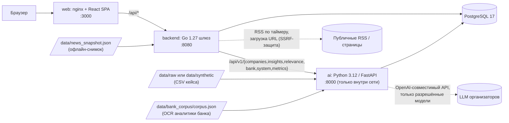
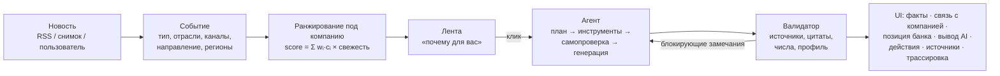

# Новостная аналитика для руководителей крупного бизнеса (Альфа-Хак 2026)

Сервис в интернет-банке Альфа-Бизнеса объясняет руководителю крупной компании, какие внешние события важны именно для неё и почему.
Он строит бизнес-контекст компании по обезличенным данным кейса (ОКВЭД, продукты банка, ВЭД, граф платежей, группа), ранжирует поток новостей с объяснимым score и для выбранного события запускает агента.
Агент собирает факты новости, позицию Альфа-Банка с дословной цитатой (документ, страница, дата) и признаки клиента, затем формулирует риски, возможности и следующий шаг.
Каждый вывод ссылается на источник. Позиция банка визуально отделена от выводов модели, а путь агента можно посмотреть во вкладке «Трассировка».
Без ключа LLM сервис работает в режиме `rules` (механизмы влияния и цитаты банка), и интерфейс прямо об этом сообщает.

---

## Содержание

1. [Что умеет (критерии кейса 01–12)](#что-умеет-критерии-кейса-0112)
2. [Архитектура](#архитектура)
3. [Требования к окружению](#требования-к-окружению)
4. [Запуск](#запуск)
5. [Переменные окружения](#переменные-окружения)
6. [Реальные данные и ключ LLM](#реальные-данные-и-ключ-llm)
7. [Сценарий проверки для жюри](#сценарий-проверки-для-жюри)
8. [Тесты](#тесты)
9. [Структура репозитория](#структура-репозитория)
10. [Известные ограничения](#известные-ограничения)
11. [Документация](#документация)
12. [Данные L03](#данные-l03)

---

## Что умеет (критерии кейса 01–12)

| № | Критерий | Как реализовано | Где видно |
|---|---|---|---|
| 01 | Бизнес-контекст и отбор событий | Профиль компании из CSV: прямые наблюдения хранятся отдельно от вычисленных признаков, у каждого указан источник. Каналы чувствительности (стоимость долга, ликвидность, ФОТ, ВЭД, спрос, топливо и др.) выводятся из продуктов, ОКВЭД и графа платежей (`ai/app/profiles.py`). Лента ранжирует новости объяснимым score (`ai/app/ranking.py`), небизнесовые и нерелевантные новости отфильтрованы с указанием причины | «Профиль компании», «Новости для бизнеса» (карточка «Почему для вас», блок «Отфильтровано») |
| 02 | Содержательная интерпретация | Механизмы «событие → признак клиента → последствие» (`ai/app/mechanisms.py`) учитывают несколько каналов и данные о контрагентах. LLM-писатель получает их как кандидатов и сверяет с доказательствами. Пробелы в данных называются явно, вместо того чтобы придумывать размер эффекта | Инсайт: «Почему важно», «Риски», «Возможности», «Ограничения» |
| 03 | Позиция Альфа-Банка отдельно от AI | Поиск по 9 документам аналитики банка (`ai/app/bank.py`). В блок «Позиция Альфа-Банка» попадают только дословные цитаты с документом, страницей и датой. «Вывод AI» показан отдельным блоком. Если материал вышел до события или устарел, это помечается | Инсайт: «Позиция Альфа-Банка» и «Вывод AI» |
| 04 | Связь с первоисточниками, минимум фактических ошибок | Реестр доказательств с ID `N:` (новость), `B:` (фрагмент аналитики), `P:` (поле профиля), `G:` (агрегат графа). Валидатор проверяет источники, цитаты, числа и противоречия профилю (`ai/app/validator.py`). Дубли новостей склеиваются, сообщения других изданий подтягиваются для сверки | Значки источников у каждого утверждения, «Замечания валидатора», ссылки «Первоисточник» |
| 05 | Работа на ранее не показанных новостях | Тип события, отрасли и каналы извлекаются по общим правилам и уточняются LLM. Правил вида «для ID X показать новость Y» в коде нет. RSS собирается по таймеру, пользователь может добавить свою новость текстом или ссылкой | Кнопка «Проверить свою новость», `POST /api/v1/news` |
| 06 | Полный сценарий до действия | Главная → лента → инсайт → риски, возможности и следующий шаг → уточняющий вопрос → первоисточник | UI на http://localhost:3000 |
| 07 | Масштабирование и сопровождение | Отрасли, события и механизмы заданы таблицами, а не кодом под конкретного клиента. Сбор новостей построен на интерфейсе `Collector`, корпус банка собирается OCR-пайплайном. Версии данных и промпта входят в ключ кэша | [docs/scaling.md](docs/scaling.md) |
| 08 | Метрики и мониторинг качества | `GET /api/v1/metrics/summary`, оценки 👍/👎, офлайн-оценка ранжирования на разметке (`eval/`) | Раздел «Мониторинг качества», [docs/monitoring.md](docs/monitoring.md) |
| 09 | Точка входа на главном экране | Пункт меню «Новости для бизнеса» со счётчиком значимых событий и блок «Новости для вашего бизнеса» на главной | Главная страница макета интернет-банка |
| 10 | Взаимодействие с аналитикой | Уточняющий вопрос по открытому инсайту с источниками, сравнение значимости одной новости для разных клиентов, переход к первоисточнику | Чат «Уточняющие вопросы», «Сравнение значимости» |
| 11 | Агентная логика | План (LLM-планировщик или правила) → инструменты из allowlist → самопроверка (найдена ли позиция банка, есть ли связь с клиентом, свежи ли материалы) → повторный поиск или осторожный вывод → валидация и доработка. Действуют лимиты шагов, времени и токенов | Ход работы агента во время генерации, вкладка «Трассировка агента» |
| 12 | Трассируемость | Каждый шаг пишется в trace: инструмент, аргументы, статус, длительность, source_id, модель и токены. Скрытые рассуждения модели не сохраняются | Вкладка «Трассировка агента», `GET /api/v1/insights/{id}/trace` |

## Архитектура



Поток обработки:



| Компонент | Технологии | Ответственность |
|---|---|---|
| `web` | React 18, Vite 5, TypeScript, nginx 1.27 | Макет интернет-банка Альфа-Бизнеса: лента, инсайт, чат, сравнение, профиль, мониторинг. Проксирует `/api` в шлюз |
| `backend` | Go 1.27, `net/http`, pgx/v5 | Единая точка API: новости (RSS-коллектор, снимок, пользовательские новости с SSRF-защитой), реестр документов банка, миграции при старте, rate limit, `X-Request-Id`, прокси в AI |
| `ai` | Python 3.12, FastAPI, pandas, httpx, psycopg 3 | Профили компаний, извлечение событий, ранжирование, RAG по аналитике банка, агент, валидатор, чат, трассировка, метрики |
| `postgres` | PostgreSQL 17 | Таблицы Go (`news`, `sources`, `knowledge_documents`) и таблицы AI (`ai_*`: события, инсайты, трассы, чат, кэш и расход LLM, отзывы) |

Подробнее: [docs/architecture.md](docs/architecture.md). Контракт API: [docs/api_contract.md](docs/api_contract.md).

## Требования к окружению

- Docker Engine 24+ и Docker Compose v2.20+ (используется `env_file` с `required: false`).
- Свободные порты 3000 и 8080. Около 4 ГБ RAM: pandas строит профили по реальным CSV при первом старте.
- Сеть не обязательна. Без неё новости берутся из `data/news_snapshot.json`, а без ключа LLM включается режим `rules`.
- Версии зафиксированы: Go — `go.mod` (`go 1.27`) и `go.sum`, образ `golang:1.27-alpine`; Python — образ `python:3.12-slim` и `ai/requirements.txt` с точными версиями; Node — образ `node:22-alpine` и `frontend/package-lock.json`.

## Запуск

```bash
git clone <repo-url> AlphaHack && cd AlphaHack
cp .env.example .env          # необязательно: здесь задаются LLM_BASE_URL / LLM_API_KEY
docker compose up --build     # UI: http://localhost:3000, API: http://localhost:8080
```

При старте происходит следующее:

1. PostgreSQL проходит healthcheck.
2. Шлюз применяет миграции `migrations/*.sql`. Если таблица `news` пуста, он загружает снимок новостей и запускает импорт RSS (сразу, затем каждые 30 минут).
3. AI-сервис создаёт свои таблицы `ai_*`, строит профили и загружает корпус банка.

Проверка готовности:

```bash
curl -s localhost:8080/health      # {"status":"ok"}
curl -s localhost:8080/ready       # {"status":"ready"} — есть связь с PostgreSQL
curl -s localhost:8080/api/v1/system/status | jq '{data_source, profiles, mode, news_in_db, corpus_version}'
```

Полный сброс состояния (БД и кэш профилей): `docker compose down -v`.

## Переменные окружения

Все переменные необязательны. Шаблон с комментариями лежит в `.env.example`. Для сервиса `ai` файл `.env` подключается целиком через `env_file`; для `backend` в `compose.yaml` пробрасываются только перечисленные там переменные.

| Переменная | Сервис | По умолчанию | Назначение |
|---|---|---|---|
| `LLM_BASE_URL` | ai | пусто | OpenAI-совместимый endpoint организаторов, например `https://changellenge.up.railway.app/v1` (запасной: `https://api.alfahack-gateway26.ru/v1`). Пусто — LLM выключена |
| `LLM_API_KEY` | ai | пусто | Ключ, например `LLM_API_KEY=sk-...`. Хранится только в `.env`, в логи не попадает |
| `LLM_MODEL_PLANNER` | ai | `GLM-5.3-Flash` | Планировщик и переформулировка поиска. Точное имя у организаторов: `z-ai/glm-5.3-flash` |
| `LLM_MODEL_EXTRACTOR` | ai | `Gemma-4-26B-A4B` | Уточнение события. Точное имя: `google/gemma-4-26b-a4b-it` |
| `LLM_MODEL_WRITER` | ai | `Qwen3.6-35B-A3B` | Генерация инсайта и доработка. Точное имя: `qwen/qwen3.6-35b-a3b` |
| `LLM_MODEL_CHAT` | ai | `Qwen3.6-35B-A3B` | Ответы на уточняющие вопросы. Точное имя: `qwen/qwen3.6-35b-a3b` |
| `LLM_DAILY_TOKEN_BUDGET` | ai | `1500000` | Суточный бюджет токенов (сутки по UTC, то есть с 03:00 МСК). Когда он исчерпан, агент переходит в режим `rules` |
| `LLM_TIMEOUT_SECONDS` / `LLM_MAX_TOKENS` | ai | `60` / `2200` | Таймаут и максимум токенов ответа на один вызов |
| `LLM_CA_FILE` | ai | пусто | Дополнительный корневой сертификат для `LLM_BASE_URL` (путь внутри контейнера, например `/data/<cert>.cer`) |
| `AGENT_MAX_STEPS` / `AGENT_MAX_SECONDS` / `AGENT_MAX_REPAIRS` | ai | `12` / `150` / `1` | Лимиты агента: шаги трассы (×2), время и число доработок по замечаниям валидатора |
| `FEED_WINDOW_DAYS` | ai | `45` | Окно ленты в днях от самой свежей новости |
| `SEGMENT_MIN_REVENUE` | ai | `5000000000` | Порог выручки для попадания в выборку. Компании от 15 млрд помечаются как крупный бизнес, 5–15 млрд — как расширенная выборка для сравнения |
| `RAW_DATA_DIR` / `DATA_DIR` / `STATE_DIR` | ai | `/data/raw`, `/data`, `/state` | Каталоги: CSV организаторов, данные репозитория, кэш профилей (том `ai_state`) |
| `DATABASE_URL` | ai, backend | задан в compose | Строка подключения к PostgreSQL. Без неё AI работает на хранилище в памяти |
| `AI_URL` | backend | `http://ai:8000` | Куда шлюз проксирует AI-маршруты |
| `NEWS_FEEDS` | backend | 7 лент | RSS-источники в формате `Имя\|url;Имя\|url`. По умолчанию: Банк России (2 ленты), РБК, Ведомости, Коммерсантъ, Лента.ру Экономика, Banki.ru |
| `NEWS_IMPORT_INTERVAL` / `NEWS_IMPORT_ON_START` | backend | `30m` / `true` | Период фонового импорта (`0` — только при старте и вручную) и импорт при старте |
| `NEWS_SNAPSHOT_PATH` | backend | `/data/news_snapshot.json` | Офлайн-снимок, загружается в пустую таблицу `news` |
| `RATE_LIMIT_PER_MINUTE` | backend | `20` | Лимит на IP для `POST /api/v1/insights`, `POST /api/v1/insights/{id}/chat`, `POST /api/v1/news` |
| `FETCH_ALLOW_CIDRS` | backend | пусто | Дополнительные служебные диапазоны для загрузки страниц по URL (fake-IP DNS у VPN). Loopback и private-адреса разрешить нельзя |
| `PORT`, `APP_ENV`, `LOG_LEVEL`, `SHUTDOWN_TIMEOUT_SECONDS` | backend | `8080`, `dev`, `info`, `10` | Параметры HTTP-сервера и логирования |
| `VITE_USE_MOCKS` | web (build arg) | `0` | `1` — сборка UI на моках без бэкенда, только для разработки фронтенда |

## Реальные данные и ключ LLM

**Данные организаторов.** Положите три CSV из кейса в `data/raw/`:

```
data/raw/df_Uid_data_hack.csv
data/raw/df_Fid_Uid_link_hack.csv
data/raw/df_Uid_payment_hack.csv
```

Каталог `data/raw/` исключён из git. AI-сервис ищет данные в таком порядке:

1. `RAW_DATA_DIR` (`/data/raw`);
2. `data/generated/profiles.json`;
3. синтетика `data/synthetic/`.

Синтетику генерирует `scripts/make_synthetic_data.py`: формат организаторов, вымышленные ID `U_9…`. Какой источник использован, видно в `GET /api/v1/system/status` (поле `data_source`) и на странице «Мониторинг качества».

Профили по реальным данным кэшируются в томе `ai_state` с ключом «каталог + порог выручки». Если вы заменили CSV в том же каталоге, удалите кэш: `docker compose down -v` или `docker volume rm <проект>_ai_state`.

**Ключ LLM.** Добавьте в `.env`:

```dotenv
LLM_BASE_URL=https://changellenge.up.railway.app/v1
LLM_API_KEY=sk-...
LLM_MODEL_PLANNER=z-ai/glm-5.3-flash
LLM_MODEL_EXTRACTOR=google/gemma-4-26b-a4b-it
LLM_MODEL_WRITER=qwen/qwen3.6-35b-a3b
LLM_MODEL_CHAT=qwen/qwen3.6-35b-a3b
```

Затем выполните `docker compose up -d --force-recreate ai`. Проверка: `curl -s localhost:8080/api/v1/system/status | jq .llm` должен вернуть `llm_enabled: true` и `models_allowed` со значением `true` для всех ролей. Модель вне списка Приложения 3 кейса отклоняется кодом до сетевого запроса (`ai/app/config.py:is_allowed_model`, `ai/app/llm.py`). Имена сравниваются без префикса провайдера и регистра, поэтому `qwen/qwen3.6-35b-a3b` и `Qwen3.6-35B-A3B` эквивалентны. Бюджет ключа организаторов — 500 ₽ в сутки, он сбрасывается в 03:00 МСК.

## Сценарий проверки для жюри

### Через UI (http://localhost:3000)

1. **Обзор.** Демо-оболочка «Альфа Бизнес» (счета на главной — демо-данные) и вход в аналитику: пункт меню «События» со счётчиком важных событий.
2. **Выбор клиента.** Селектор компании в верхней панели, рядом — отрасль по ОКВЭД. Плашка «неполный профиль» означает, что в данных нет ключевых полей. Без реальных CSV доступны синтетические компании `U_9…`.
3. **«События».** Заголовок «Что важно для вашей компании» и сводка: событий в ленте, важных, с аналитикой банка (карточки сводки работают как фильтры). Слева — лента, ранжированная под клиента: уровень значимости, дата, «Почему для вас». Сортировка по значимости или по дате. Отфильтрованные новости — отдельным блоком с причиной.
4. **Подробности события** (справа; на телефоне — отдельный экран с «Назад к событиям»). Блоки подписаны по происхождению: «Факт из новости», «Почему это важно» (с раскрытием «На основании чего» — поля профиля и граф платежей), «Аналитика Альфа-Банка», «Оценка ИИ».
5. **«Разобрать для компании».** Запускает агента; шаги видны по мере выполнения. Готовый инсайт: «Что это значит для компании» (риски, возможности — оценка ИИ, а не факт), «Позиция Альфа-Банка» (дословная цитата, документ, страница, дата или сообщение, что материал не найден), «Что можно сделать», «Источники». Если LLM недоступна, стоит метка «Сформировано правилами». Повторный запрос отдаётся из кэша, «Пересчитать» запускает заново.
6. **Источники и «Как получен вывод».** У утверждений значки `N:`, `B:`, `P:`, `G:` с происхождением; ссылка на первоисточник. Под «Как получен вывод» — трассировка агента: план, инструменты, проверки, повторные поиски, валидация, модели, токены.
7. **Уточняющий вопрос** — поле «Задайте вопрос по этой новости» внизу панели, например «Как это повлияет на обслуживание кредитов?». Ответ со ссылками на источники; контекст привязан к текущей компании и инсайту.
8. **«Сравнение значимости»** (меню «Дополнительно» или «Сравнить для других клиентов» у события): одна новость — разный score и разные причины у разных компаний.
9. **«Проверить новость»** — красная кнопка в верхней панели. Вставьте текст или ссылку на свежую публикацию: новость попадёт в ленту и пройдёт тот же анализ.
10. **«Источники»** — реестр документов аналитики Альфа-Банка. **«Качество»** — режим (LLM или правила), источник данных, версии корпуса и профилей, доля инсайтов, прошедших валидацию, доля с найденной позицией банка, задержка, токены и оценки пользователей.

Эталонная пара для проверки персонализации на реальных данных: `U_1595` (розница одеждой, есть кредит и лизинг в банке) и `U_8167` (розница продуктами, кредитных продуктов в банке нет). Новость для обеих — решение Банка России по ключевой ставке от 23.10.2026. Подробный сценарий показа с репликами: [docs/demo_script.md](docs/demo_script.md).

### Через API (curl)

Все запросы идут через шлюз `:8080`. Для доступа к инсайтам, трассам и чату нужен заголовок `X-Client-Id`, совпадающий с компанией инсайта: без заголовка вернётся 401, с чужой компанией — 403. Ниже используется `jq`.

```bash
API=localhost:8080/api/v1

# 1. Компании и профиль
curl -s "$API/companies?limit=5" | jq '.data_source, [.items[] | {company_id, subtitle, completeness, top_channels}]'
A=$(curl -s "$API/companies?limit=1" | jq -r '.items[0].company_id')        # на реальных данных можно взять A=U_1595
B=$(curl -s "$API/companies?limit=2" | jq -r '.items[1].company_id')        # и B=U_8167
curl -s "$API/companies/$A" | jq '{summary, channels: [.channels[] | {label, strength, basis}], data_notes}'

# 2. Персонализированная лента
curl -s "$API/companies/$A/feed?limit=5" | jq '.stats, [.items[] | {news_id, title, level: .relevance.level, score: .relevance.score, why: .relevance.why_short}]'
NEWS=$(curl -s "$API/companies/$A/feed?limit=1" | jq -r '.items[0].news_id')

# 3. Та же новость для двух компаний
curl -s "$API/relevance?news_id=$NEWS&company_ids=$A,$B" | jq '[.results[] | {company_id, score: .relevance.score, level: .relevance.level, reasons: .relevance.reasons}]'

# 4. Инсайт (асинхронно: 202 → опрос статуса)
IID=$(curl -s -X POST "$API/insights" -H 'Content-Type: application/json' -H "X-Client-Id: $A" \
  -d "{\"company_id\":\"$A\",\"news_id\":\"$NEWS\",\"role\":\"cfo\"}" | jq -r .insight_id)
for i in $(seq 90); do
  S=$(curl -s "$API/insights/$IID" -H "X-Client-Id: $A" | jq -r .status)
  [ "$S" = completed ] || [ "$S" = failed ] && break; sleep 2
done
curl -s "$API/insights/$IID" -H "X-Client-Id: $A" | jq '.result | {mode, headline, bank_view, ai_conclusions, validation}'

# 5. Трассировка агента
curl -s "$API/insights/$IID/trace" -H "X-Client-Id: $A" | jq '.summary, [.steps[] | {step, kind, name, status, output_summary}]'

# 6. Уточняющий вопрос
curl -s -X POST "$API/insights/$IID/chat" -H 'Content-Type: application/json' -H "X-Client-Id: $A" \
  -d '{"question":"Как это повлияет на обслуживание кредитов?"}' | jq '.message | {mode, content, statements}'

# 7. Граница доступа: контекст другой компании → 403, без заголовка → 401
curl -s -o /dev/null -w '%{http_code}\n' "$API/insights/$IID" -H "X-Client-Id: $B"
curl -s -o /dev/null -w '%{http_code}\n' "$API/insights/$IID"

# 8. Своя (ранее не показанная) новость → значимость для двух компаний
NID=$(curl -s -X POST "$API/news" -H 'Content-Type: application/json' \
  -d '{"title":"Минфин предложил повысить НДС","text":"Минфин внёс в правительство предложение о повышении ставки НДС со следующего года."}' | jq -r .id)
curl -s "$API/relevance?news_id=$NID&company_ids=$A,$B" | jq '.event.event_label, [.results[] | {company_id, level: .relevance.level, why: .relevance.why_short}]'

# 9. Новости, аналитика банка, мониторинг
curl -s "$API/news?limit=3" | jq '[.items[] | {title, source_name, origin}]'
curl -s "$API/bank/search?q=ключевая%20ставка&k=3" | jq '[.items[] | {doc_title, page, published_at, score, warning}]'
curl -s "$API/metrics/summary" | jq
```

**OpenAPI.** Готовая спецификация AI-сервиса лежит в [`docs/openapi_ai.json`](docs/openapi_ai.json). Сервис также отдаёт `/docs` (Swagger UI) и `/openapi.json`; его порт наружу не публикуется, поэтому актуальную версию можно выгрузить так:

```bash
docker compose exec ai python -c "import urllib.request;print(urllib.request.urlopen('http://127.0.0.1:8000/openapi.json').read().decode())" > openapi.json
```

Маршруты Go-шлюза описаны в [docs/api_contract.md](docs/api_contract.md).

## Дополнительно: импорт PDF в базу знаний и парсер РБК

Эти функции шлюза не нужны для сквозного сценария (он работает на `data/bank_corpus/corpus.json` и RSS), но доступны:

- **Импорт PDF аналитики** в PostgreSQL (`knowledge_documents` + `knowledge_chunks`, миграция `005_knowledge_chunks.sql`):
  текстовый слой по страницам, OCR (poppler + tesseract rus/eng, 150 DPI) только для страниц без текста, дедупликация по SHA-256.
  - `POST /api/v1/knowledge/import` — один PDF, multipart-поле `file`;
  - `POST /api/v1/knowledge/collect` — все PDF из `./data/knowledge` (в контейнере `/data/knowledge`; папка и PDF не в git).
- **Парсер РБК** (`parsing_rbk_lentaru/`, FastAPI + Natasha: полный текст статей, найденные компании и ОКВЭД) — отдельный
  необязательный сервис. Первый запуск долгий (зависимости и модели), лимит памяти 4 ГБ. Включение:
  ```bash
  RBC_PARSER_URL=http://rbc-parser:8000 docker compose --profile rbc up --build
  ```
  Шлюз импортирует РБК отдельно от RSS по тому же таймеру `NEWS_IMPORT_INTERVAL`; без `RBC_PARSER_URL` коллектор выключен,
  и стек от парсера не зависит. Найденные парсером компании и ОКВЭД пока не сохраняются в схеме `news`.
- Коллектор публикаций `alfabank.ru/news` (дата публикации на странице не размечена — публикация сохраняется без даты).
- Исходный Go-контракт сохранён: `GET /api/v1/legacy/companies[/{id}[/feed]]`, `POST /api/v1/companies/{id}/analyses`,
  `GET /api/v1/analyses/{id}`.

## Тесты

```bash
# AI-сервис: ядро (события, ранжирование, валидатор, агент в режимах rules и LLM на фейковом транспорте, доступ),
# LLM-клиент (allowlist, бюджет, кэш, повторы, отсутствие ключа и промптов в логах), хранилище, сквозной API-тест
docker run --rm -v "$PWD":/repo -w /repo/ai python:3.12-slim \
  sh -c "pip install -q -r requirements-dev.txt && python -m pytest -q"
# Тесты PgStore включаются переменной TEST_DATABASE_URL=postgresql://...

# Go-шлюз: RSS-парсер, SSRF-защита, импорт, прокси в AI, rate limit, конфигурация
docker run --rm -v "$PWD":/src -w /src golang:1.27-alpine go test ./...

# Фронтенд: проверка типов и сборка
docker run --rm -v "$PWD/frontend":/app -w /app node:22-alpine sh -c "npm ci && npm run build"

# Сквозной сценарий на поднятом стеке (docker compose up --build): UI, лента, разная значимость,
# 403 для чужого клиента, инсайт, трассировка, уточняющий вопрос, мониторинг.
# На реальных данных проверяет пару U_1595/U_8167, на синтетике сам берёт две компании U_9…
./scripts/smoke_test.sh

# Офлайн-оценка ранжирования на ручной разметке (Precision@3, nDCG@5, dev/holdout, сравнение с baseline)
docker run --rm -v "$PWD":/repo -w /repo python:3.12-slim \
  sh -c "pip install -q -r ai/requirements.txt && python eval/evaluate.py"
```

## Структура репозитория

```
├── compose.yaml, Dockerfile, .env.example   единый запуск; Dockerfile — Go-шлюз
├── cmd/api/                                 точка входа шлюза (миграции, снимок, импорт, graceful shutdown)
├── internal/
│   ├── config/                              env-конфигурация
│   ├── http/                                маршруты, прокси в AI, rate limit, middleware (request id, логи, заголовки)
│   ├── news/                                RSS, alfabank.ru и РБК-коллекторы, импорт, снимок, пользовательские новости, SSRF-защита
│   ├── knowledge/                           реестр документов банка, импорт PDF с OCR в knowledge_chunks
│   ├── company/, analysis/                  исходный Go-контракт (legacy-компании, анализы)
│   ├── storage/                             пул PostgreSQL и применение миграций
│   └── response/                            формат JSON-ответов и ошибок
├── migrations/                              SQL-миграции шлюза (embed)
├── ai/
│   ├── app/                                 AI-сервис (FastAPI)
│   │   ├── main.py                          API, граница доступа, очередь инсайтов
│   │   ├── data_build.py, profiles.py       профили компаний, граф платежей, каналы чувствительности
│   │   ├── sectors.py, events.py            таксономия ОКВЭД → сектора; извлечение события
│   │   ├── ranking.py, feed.py              объяснимый score, лента, склейка дублей
│   │   ├── bank.py                          поиск по аналитике банка (BM25 + синонимы)
│   │   ├── agent.py, tools.py, evidence.py  агент, инструменты (allowlist), реестр доказательств
│   │   ├── mechanisms.py, writer.py         механизмы влияния; LLM-писатель и писатель на правилах
│   │   ├── validator.py, chat.py            проверка обоснованности; уточняющие вопросы
│   │   ├── llm.py, config.py                клиент LLM, allowlist моделей, бюджет, кэш
│   │   └── storage.py, textproc.py          PostgreSQL / память; нормализация текста
│   ├── tests/                               pytest
│   └── requirements*.txt, Dockerfile
├── frontend/                                React + Vite + TS, nginx.conf, package-lock.json
├── data/
│   ├── synthetic/                           синтетические CSV в формате организаторов
│   ├── bank_corpus/corpus.json              распознанная аналитика Альфа-Банка (9 документов, 219 фрагментов)
│   ├── news_snapshot.json (+ README)        офлайн-снимок 200 реальных публикаций из RSS
│   └── raw/, generated/                     реальные данные и производные (не в git)
├── parsing_rbk_lentaru/                     необязательный парсер РБК (Natasha, ОКВЭД), compose profile rbc
├── scripts/                                 OCR (Apple Vision) → корпус; синтетика; снимок новостей
├── eval/                                    разметка и офлайн-оценка ранжирования
├── 03_data/                                 подготовка и валидация исходных данных (L03)
└── docs/                                    контракт API, архитектура, безопасность, мониторинг, масштабирование, демо, чек-лист
```

## Известные ограничения

- **OCR аналитики банка.** PDF кейса — сканы без текстового слоя. Текст распознан Apple Vision. Таблицы и графики распознаются частично: 23 из 219 фрагментов помечены `table_like`, в поиске им дан пониженный вес, а как позиция банка они не цитируются.
- **Устаревший материал.** Документ о стали (апрель 2021) помечен как отраслевой фон. Если материал банка вышел задолго до события (больше 120 дней), рядом с цитатой показывается предупреждение.
- **Комментариев банка к событиям после середины сентября 2026 в корпусе нет.** Для более поздних событий показывается позиция или прогноз банка на дату документа с явной пометкой.
- **Данные платежей.** Период и единицы платежей в датасете не указаны, суммы показываются как «объём в единицах датасета». Платёж не доказывает, что контрагент поставщик или покупатель, а связь с физлицом не означает владения. Позиция по выручке в выборке — не доля рынка.
- **Регион.** Есть только регион регистрации, а не регионы присутствия.
- **Новости.** RSS даёт короткие анонсы: у 76 из 200 записей снимка нет описания, полные тексты есть только у пресс-релизов ЦБ и РБК. Поэтому вывод по таким новостям опирается в основном на заголовок.
- **Оценка качества** — офлайн на 100 парах «компания × новость», 10 компаний (`eval/`). Метки автоматические (один разметчик — автор правил) плюс вторая независимая разметка моделью (`eval/llm_annotate.py`); ручной проверки командой не было. Результаты и оговорки: [docs/evaluation_report.md](docs/evaluation_report.md).
- **LLM-режим.** Цепочка планирование (GLM) → извлечение (Gemma) → генерация (Qwen) → валидация → доработка → чат проверена на endpoint организаторов: инсайт ≈30–60 с и 10–20 тыс. токенов, валидатор ловит неподтверждённые числа, агент дорабатывает ответ. Детерминированные тесты LLM-ветки — на фейковом HTTP-транспорте (`ai/tests/test_core.py`, `ai/tests/test_llm.py`). Ограничение — общий суточный бюджет ключа (500 ₽/день, сброс в 03:00 МСК); при исчерпании сервис переключается в режим rules. Reasoning у моделей шлюза отключён (`LLM_REASONING=off`): «размышления» съедают лимит токенов и не нужны для JSON-ответа.
- **Доступ.** `X-Client-Id` в прототипе задаётся интерфейсом по выбранному клиенту — это демонстрация границы доступа, а не аутентификация. Профили и ленты доступны без привязки к пользователю, чтобы можно было переключать клиентов и сравнивать их. План для production описан в [docs/security.md](docs/security.md).
- **Роль пользователя.** UI отправляет роль `cfo`. API принимает также `ceo`, `treasurer` и `accountant`; роль влияет на формулировки и входит в ключ кэша.
- **Очередь инсайтов** работает в процессе AI-сервиса (4 потока). Для нескольких реплик нужна внешняя очередь ([docs/scaling.md](docs/scaling.md)).

## Документация

| Документ | Содержание |
|---|---|
| [docs/api_contract.md](docs/api_contract.md) | Контракт API v1 (шлюз и AI), схемы Insight, Source, Trace |
| [docs/architecture.md](docs/architecture.md) | Компоненты, модель данных, агентный цикл, ранжирование, RAG, валидатор |
| [docs/security.md](docs/security.md) | Реализованные меры безопасности и план для production |
| [docs/monitoring.md](docs/monitoring.md) | Метрики качества и процесс мониторинга |
| [docs/scaling.md](docs/scaling.md) | Новые отрасли, клиенты и источники, горизонтальное масштабирование, сопровождение |
| [docs/demo_script.md](docs/demo_script.md) | Сценарий демонстрации и ответы на вопросы |
| [docs/demo_companies.md](docs/demo_companies.md) | Демо-компании и чем они различаются по данным |
| [docs/evaluation_report.md](docs/evaluation_report.md) | Офлайн-оценка ранжирования |
| [docs/submission_checklist.md](docs/submission_checklist.md) | Чек-лист сдачи |
| [THIRD_PARTY_NOTICES.md](THIRD_PARTY_NOTICES.md) | Сторонние компоненты, модели, датасеты, смоделированные интеграции |
| [data/news_snapshot_README.md](data/news_snapshot_README.md) | Как собран снимок новостей |

## Данные L03

Подготовка и валидация исходных датасетов кейса: сохранение ID, сумм и пропусков, флаги дублей, неоднозначных профилей и самопереводов, отчёт об очистке. Описание, правила обработки и запуск — в [03_data/README.md](03_data/README.md). Те же принципы применяются при построении профилей в `ai/app/data_build.py`: пропуск остаётся пропуском, повторяющийся ID получает статус `ambiguous`, косвенные признаки не превращаются в факты.
