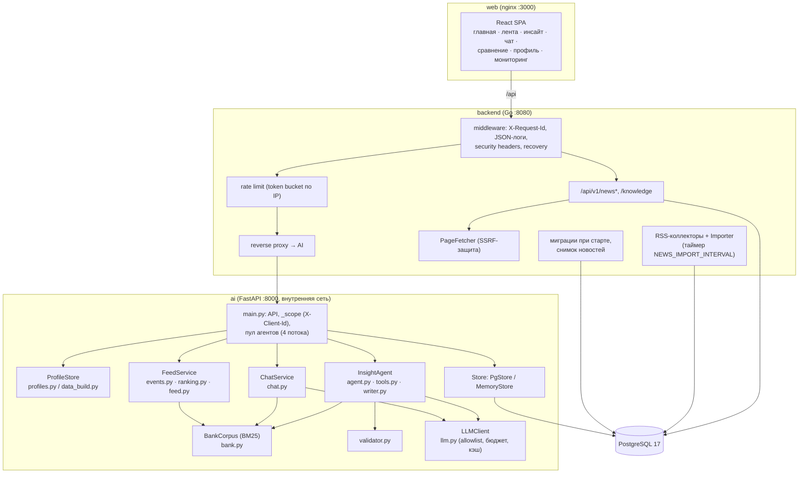
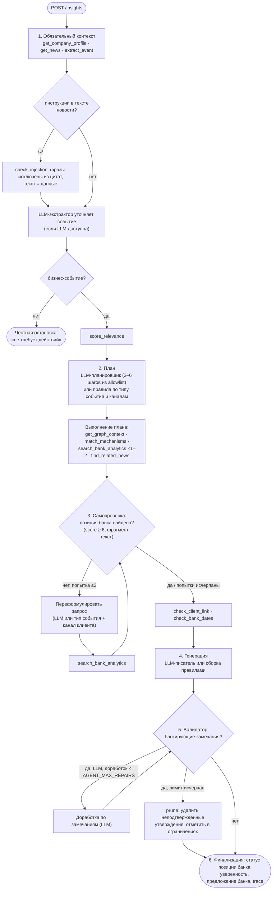

# Архитектура

Документ описывает, как устроен прототип: компоненты, данные, агентный цикл, ранжирование, поиск по аналитике банка и проверка результата. Формат запросов и ответов — в [api_contract.md](api_contract.md).

## 1. Компоненты



Наружу опубликованы только порты `web:3000` и `backend:8080`. AI-сервис и PostgreSQL доступны только внутри docker-сети. Шлюз проксирует в AI префиксы `/api/v1/{companies,insights,relevance,bank,system,metrics}` без изменения пути. Заголовки `X-Request-Id`, `X-Client-Id` и `X-User-Role` передаются дальше, тело запроса ограничено 1 МБ.

**Старт системы.**

1. Шлюз применяет миграции (`internal/storage/migrate.go`) и удаляет дубли новостей (`Repository.Deduplicate`).
2. Если таблица `news` пуста, шлюз загружает `data/news_snapshot.json` (`LoadSnapshotIfEmpty`), затем запускает импорт RSS: сразу и по таймеру.
3. AI создаёт свои таблицы (`ensure_schema`), строит профили (`ProfileStore.load`) и загружает корпус банка (`BankCorpus.load`).

## 2. Модель данных

### 2.1 Таблицы шлюза (Go, `migrations/`)

| Таблица | Ключевые поля | Назначение |
|---|---|---|
| `sources` | `id`, `name` (unique), `base_url` | Источник новостей (лента, издание, «Добавлено пользователем») |
| `news` | `id` UUID, `source_id`, `title`, `summary`, `content`, `url` (unique, нормализован), `published_at`, `fetched_at`, `origin` (`collector`/`snapshot`/`user`) | Все новости. AI их только читает |
| `knowledge_documents` | `doc_key` (unique), `title`, `institution`, `document_url`, `published_at` | Реестр 9 документов аналитики банка (`GET /api/v1/knowledge`) |
| `companies`, `persons`, `company_persons`, `company_news`, `analyses`, `analysis_results`, `analysis_sources` | — | Остались от первоначального каркаса (`001_init.sql`) и текущей логикой не используются. Профили компаний строятся AI-сервисом из CSV |

### 2.2 Таблицы AI-сервиса (`ai/app/storage.py`, префикс `ai_`)

| Таблица | Ключ | Содержимое |
|---|---|---|
| `ai_news_events` | (`news_id`, `extractor`) | Кэш извлечённого события (JSON) по версии экстрактора (`rules-1.2`) |
| `ai_insights` | `id`; индекс `cache_key` | Статус (`queued`/`processing`/`completed`/`failed`), режим, прогресс шагов, результат Insight, `trace_id` |
| `ai_traces` | `trace_id` | Шаги агента или чата и сводка: режим, число вызовов инструментов и LLM, токены, длительность, план, адаптации |
| `ai_chat_messages` | `id`; индекс (`insight_id`, `id`) | История уточняющих вопросов, изолированная по инсайту и компании |
| `ai_llm_usage` | (`day`, `model`) | Вызовы и токены за сутки (UTC) — основа дневного бюджета |
| `ai_llm_cache` | `key` = sha256(модель + сообщения + режим + max_tokens) | Кэш ответов LLM: повторный запрос не тратит бюджет |
| `ai_feedback` | `id`; индекс `insight_id` | Оценки пользователей (+1/−1, причина) |

Если `DATABASE_URL` не задан, используется `MemoryStore` с теми же методами. Снимок новостей он загружает сам — так работают тесты и запуск без БД.

### 2.3 Профиль компании (в памяти AI, из CSV)

Профиль строит `data_build.build_profiles` из трёх CSV организаторов или синтетики в том же формате:

- `observed` — прямые наблюдения (24 поля справочника) с источником `файл:поле`. Пропуск остаётся `null` и попадает в `missing_fields`.
- `products` — флаги продуктов банка.
- `derived` — вычисленные признаки:
  - `revenue_rank` — место по выручке в классе ОКВЭД внутри выборки; это не доля рынка;
  - `group` — участники группы и сумма их выручки;
  - `payments_out` и `payments_in` — граф платежей на один шаг: число контрагентов, доля топ-5, распределение по отраслям, регионам и странам ФТС, топ контрагентов; самопереводы исключены;
  - `persons` — связанные физлица и компании, связанные через общих физлиц.
- `channels` — каналы чувствительности (раздел 4.2).
- `profile_status`: `matched`, или `ambiguous`, если ID встречается в справочнике несколько раз. Для `ambiguous` атрибуты не выбираются.
- `segment` — «Крупный бизнес (≥ 15 млрд)» или «Выручка 5–15 млрд (расширенная выборка)»; порог отбора задаёт `SEGMENT_MIN_REVENUE`.
- `data_notes` — оговорки о данных.

### 2.4 Контракт Insight

Полная схема описана в [api_contract.md](api_contract.md#инсайты-ai-агент). Ключевые свойства:

- блоки `what_happened` (только `N:`), `why_it_matters` (только `P:`/`G:`), `risks`, `opportunities`, `ai_conclusions`, `actions`;
- `bank_view` со статусом `found`/`not_found`/`outdated` и цитатами;
- `bank_offer` (помечено как предложение банка), `related_news`, `limitations`, `confidence`, `validation`, `sources`;
- у каждого утверждения есть `kind`: `fact`, `client_link`, `ai_conclusion`, `bank_view`, `action`, `question` или `scenario`;
- `mode` (`llm`/`rules`), модели и `prompt_version` фиксируются в результате.

## 3. Агентный цикл

Реализация: `ai/app/agent.py` (`InsightAgent.run`), инструменты — `ai/app/tools.py`, общий контекст — словарь `ctx` и реестр доказательств `Evidence` (`ai/app/evidence.py`).



**Планирование.**

- В режиме LLM планировщик (`LLM_MODEL_PLANNER`) получает каталог разрешённых инструментов (`ALLOWED_PLAN_TOOLS`), краткий профиль и событие. Он возвращает JSON со шагами и обоснованием каждого.
- Шаги вне allowlist отбрасываются. Аргументы `company_id` и `news_id` всегда подставляются из текущего контекста, а не из ответа модели.
- Если в плане нет `match_mechanisms` и `search_bank_analytics`, вместо него используется план на правилах.
- План на правилах строится по типу события и сильнейшему каналу клиента: граф, механизмы, поиск позиции банка по теме и по каналу, связанные новости.

**Инструменты.** Все восемь инструментов только читают данные и проверяют аргументы. Работать они могут только с компанией и новостью текущего анализа.

| Инструмент | Что возвращает | source_id |
|---|---|---|
| `get_company_profile` | Наблюдаемые поля и каналы | `P:<поле>` |
| `get_graph_context` | Отрасли, регионы и страны контрагентов, концентрация, группа, место в выборке, физлица | `G:<путь>` |
| `get_news` | Текст и метаданные новости | `N:<uuid>` |
| `extract_event` | Тип события, отрасли, каналы, направление, регионы, участники, цитаты | `N:` |
| `score_relevance` | Объяснимый score и компоненты | `P:`, `G:` |
| `search_bank_analytics` | Фрагменты аналитики с документом, страницей, датой и предупреждением | `B:<chunk>` |
| `find_related_news` | Сообщения других источников о том же событии (±4 дня, сходство заголовков ≥ 0,3) | `N:` |
| `match_mechanisms` | Применимые механизмы «канал × тип события × направление», пробелы в данных | `P:`, `G:` |

**Контекст.** Результаты шагов сохраняются в `ctx` и используются дальше: профиль, событие, найденные фрагменты банка, механизмы, связанные новости, релевантность. Всё, на что можно сослаться, попадает в `Evidence` с единым ID. LLM-писатель получает только блок доказательств и может ссылаться только на его ID, а валидатор проверяет утверждения по тому же реестру.

**Самопроверка и адаптация.**

- `check_bank_evidence` — если релевантного текстового фрагмента нет, выполняются до двух повторных поисков с переформулировкой: сначала тип события и вторичные типы, затем главный канал клиента.
- `check_client_link` — если механизмов нет и score ниже 0,2, вывод формулируется осторожно и с низкой уверенностью.
- `check_bank_dates` — если материалы старше события более чем на 120 дней, это попадает в предупреждения, а статус позиции банка становится `outdated`.
- `check_business_relevance` — если новость не о бизнесе, агент честно останавливается без генерации.
- Если LLM-генерация не удалась, используется генератор на правилах. Это записывается в `adaptations`, и `mode` становится `rules`.

**Лимиты.**

| Лимит | Значение по умолчанию |
|---|---|
| Записи трассы (`AGENT_MAX_STEPS`) | 12 × 2 = 24 |
| Время (`AGENT_MAX_SECONDS`) | 150 с |
| Доработки по замечаниям (`AGENT_MAX_REPAIRS`) | 1 |
| Токенов на вызов (`LLM_MAX_TOKENS`) | 2200 |
| Таймаут вызова LLM | 60 с, один повтор при таймауте, 429 или 5xx |
| Суточный бюджет токенов | Общий для всех ролей |

При превышении лимитов шагов или времени оставшиеся шаги плана пропускаются, и инсайт собирается из уже найденного.

**Режим `rules`.** Без LLM работают те же инструменты, план на правилах, самопроверка и валидатор. Текст собирается из фактов новости (предложения с триггерами события или числами), механизмов влияния (`mechanisms.py`, 29 шаблонов «канал × тип события × направление»), дословных фрагментов аналитики банка и сверки события с прогнозом банка (`writer.forecast_check`, например «решение совпало с ожиданием из материала от 11.09»). Пробелы в данных (`mechanisms.GAPS`) попадают в ограничения.

**Трасса.** Каждый шаг записывается в `ai_traces`: номер, вид (`plan`/`tool`/`check`/`llm`/`validate`/`repair`/`final`), имя, статус, время начала и длительность, вход (аргументы), краткий результат (до 600 символов), source_id, заметки, модель, токены. Тексты промптов и рассуждения модели не сохраняются: блоки `<think>` удаляются в `llm.strip_think`. Прогресс выполнения обновляется в `ai_insights.progress`, и UI показывает шаги во время работы.

**Кэш инсайтов.** Ключ — sha256 от:

- компании, новости и роли;
- версий профилей, корпуса банка и промпта;
- режима (`llm`/`rules`);
- хэша текста новости.

Новая версия данных или промпта даёт новый инсайт. Флаг `force: true` пересчитывает инсайт без кэша.

**Уточняющие вопросы** (`ai/app/chat.py`):

1. Вопрос классифицируется по интенту: источники, долг, контрагенты, валюта, персонал, горизонт.
2. Источники инсайта загружаются в реестр.
3. Выполняется дополнительный поиск в аналитике банка; для интента «контрагенты» добавляются агрегаты графа.
4. Ответ даёт LLM (`LLM_MODEL_CHAT`) в JSON. Утверждения без существующего источника или с числами, которых нет в источниках, отбрасываются.
5. Без LLM ответ собирается из уже проверенных утверждений инсайта и фрагментов банка. Ответ чата получает собственный `trace_id`.

## 4. Ранжирование (`ai/app/ranking.py`)

### 4.1 Формула

```
raw   = Σ wᵢ · cᵢ,      cᵢ ∈ [0, 1]
raw   = raw × 0.6,      если max(c_sector, c_channel, c_counterparty) < 0.2   (нет связи с компанией)
score = raw × freshness, freshness = 0.6 + 0.4 · exp(−age_days / 10)
level = high ≥ 0.45 · medium ≥ 0.30 · low ≥ 0.18 · иначе none (в «Отфильтровано» с причиной low_relevance)
```

| Компонент | Вес | Как считается | Доказательство |
|---|---|---|---|
| `sector` — отрасль | 0.27 | Сектор события совпал с основным сектором компании или совпало несколько секторов — 1.0, совпал неосновной — 0.75. Для макрособытий (ставка, инфляция, курс, ВВП, бюджет, рынок труда, кредитный рынок) множитель 0.3 | `P:MAINOKVED_CODE` |
| `channel` — каналы влияния | 0.30 | max(вес канала у события × сила канала у компании) + 0.15 × второй канал | `P:`/`G:` из basis канала |
| `counterparty` — контрагенты | 0.12 | min(1, 2.5 × доля платежей с контрагентами из отраслей события), считается при доле ≥ 2%; для макрособытий × 0.3 | `G:payments_out.sectors` / `G:payments_in.sectors` |
| `region` — регион | 0.08 | 1, если регион регистрации упомянут в новости | `P:REGION` |
| `macro` — макрозначимость | 0.15 | Базовая значимость типа события: от 0.85 для ключевой ставки до 0.15 для золота | — |
| `bank` — покрытие аналитикой | 0.08 | min(1, лучший BM25-score / 25) по запросу события | — |

**Уверенность.** `high`, если нет пропусков в ключевых полях (`MAINOKVED_CODE`, `REGION`, `CL_PRODUCT_LOA_MARK`, `AMOUNT_WORKERS_FNS_GRADATION`, `REVENUE_COMPANY`) и персональная связь ≥ 0.5. `medium`, если пропущено не больше одного поля. Иначе `low`. Неполный или неоднозначный профиль даёт предупреждение `profile_warnings`, а неизвестные признаки не добавляют баллов.

**Порядок ленты.** Повтор того же типа события и отрасли понижает позицию (× 0.9ᵏ), при этом score в карточке не меняется. Сообщения об одном событии склеиваются: сходство заголовков ≥ 0.45 в пределах 3 дней. Представителем кластера становится запись с самым длинным текстом, остальные показываются как `duplicates` со ссылками.

### 4.2 Каналы чувствительности (`ai/app/profiles.py:channels_for`)

| Канал | Откуда берётся сила (basis) |
|---|---|
| `cost_of_debt` — стоимость заёмного финансирования | Кредит 0.9, лизинг 0.6, факторинг 0.5, гарантии 0.35 (+0.05 за каждый дополнительный продукт) |
| `liquidity_yield` — доходность ликвидности | Депозит 0.7 |
| `payroll` — расходы на персонал | Численность по ФНС (более 251 — 0.6, 101–250 — 0.4, 16–100 — 0.2); зарплатный проект 0.4 |
| `foreign_trade` — ВЭД и курс | `FTS_FLAG=1` — 0.8; доля платежей контрагентам с ВЭД ≥ 10% — 0.35 |
| `consumer_demand` — потребительский спрос | Розница или общепит 1.0; потребительские товары, авто, агро+опт 0.6; входящие платежи от розницы ≥ 5% — 0.4 |
| `fuel_costs` — топливо и энергия | Топливный сектор 0.9; транспорт, агро, стройка 0.5; платежи топливным контрагентам ≥ 5% |
| `metals_prices` — металлы | Металлургия 0.9; стройка, машиностроение, авто 0.45 |
| `construction_cycle` — строительный цикл | Стройка или недвижимость 0.9; покупатели из стройки ≥ 10% — 0.4 |
| `state_budget` — госрасходы и налоги | Стройка, ЖКХ, госсектор 0.5 |
| `agri_prices` — агроцены | Агро и пищевая промышленность 0.8 |
| `financial_markets` — финансовые рынки | Финансовый сектор 0.8 |

Повторное подтверждение канала добавляет 0.1, максимум — 1.0. У каждого канала есть `basis` (ссылки на поля и агрегаты) и пояснение — они показываются в карточке «Почему для вас» и в профиле.

### 4.3 Событие (`ai/app/events.py`)

Извлекатель на правилах (`rules-1.2`) работает по лексикону стемм; совпадение в заголовке весит вдвое больше, чем в тексте. Он определяет:

- тип события — 17 типов, плюс `industry` и `non_business`, и вторичные типы;
- отрасли — 17 секторов лексикона;
- каналы с весами, направление (`up`/`down`/`hold`), регионы из справочника компаний, участников;
- дату из заголовка;
- до трёх подтверждающих цитат (предложения с фразами-инструкциями пропускаются);
- признак `suspicious_instructions`.

Небизнесовые новости (спорт, культура, происшествия) получают `non_business`. LLM-экстрактор может только уточнить тип события, если правила дали `industry`, `regulation` или `non_business`, и добавить цитаты, которые дословно присутствуют в тексте. Все значения ограничены теми же перечислениями.

## 5. RAG по аналитике Альфа-Банка (`ai/app/bank.py`)

**Корпус.** 9 PDF-сканов из Приложения 2 кейса подготовлены так:

1. Страницы распознаны Apple Vision (`scripts/ocr_vision.swift`, ru+en, 200 dpi).
2. `scripts/build_bank_corpus.py` восстанавливает порядок чтения по колонкам, убирает колонтитулы и дисклеймер, режет текст на фрагменты около 700 символов по предложениям.
3. Фрагменты, похожие на распознанные таблицы, помечаются `quality=table_like`.

Итог: `data/bank_corpus/corpus.json`, 219 фрагментов (23 `table_like`). Версия корпуса — хэш фрагментов. У каждого документа есть `published_at`, `topics`, ссылка на файл организаторов и `date_note`. Материал о стали 2021 года помечен: «использовать только как отраслевой фон, не как текущую позицию банка».

**Поиск** работает без embedding-модели, поскольку embedding-моделей нет в списке разрешённых:

1. **BM25** (k1 = 1.2, b = 0.75) по стеммированным токенам фрагмента и заголовка документа.
2. **Синонимы.** Запрос расширяется словарём `SYNONYMS`, например «ставк» → «ключев», «дкп», «цб», «процент».
3. **Множители:**
   - × 1.25 — во фрагменте есть маркеры позиции или прогноза банка («мы ожидаем», «прогноз», «наш взгляд»);
   - × 0.5 — фрагмент `table_like`;
   - × (1 + 0.8 · доля слов запроса в заголовке документа);
   - × 1.4 — тема документа совпала с темой события;
   - × (1 + 0.3 · exp(−возраст/60)) — свежесть: предпочтение более свежей позиции, если документ вышел до события.
4. **Отсечения:** score ≥ 2.5, не больше двух фрагментов из одного документа, по 4 результата на вызов агента; уже найденные фрагменты исключаются.

**Выбор позиции банка** (`writer.select_bank_hits`). Берутся фрагменты со score ≥ 6 и качеством `text`. Среди документов, чей лучший фрагмент дотягивает хотя бы до 45% от лучшего результата, предпочитаются более свежие. Внутри документа выбирается фрагмент с прогнозом или позицией.

**Цитата и предупреждения.** Цитата — предложение фрагмента, больше всего пересекающееся с запросом. Каждый результат несёт документ, страницу, дату, ссылку и `warning`: это `date_note` документа или «опубликован за N дней до события», если N > 120. Если все цитаты с предупреждениями, статус блока — `outdated`. Если материалы вышли до события, в примечании сказано, что это позиция на дату документа, а не комментарий к событию. Документы банка не подменяются материалами из интернета.

## 6. Валидатор (`ai/app/validator.py`)

Валидатор запускается после генерации, после каждой доработки и после `prune`.

| Код | Серьёзность | Проверка |
|---|---|---|
| `schema` | blocking / warning | Есть все блоки-списки, есть факты события, у утверждений есть текст; статус `found` не бывает без утверждений банка (blocking); заголовок (warning) |
| `unknown_source` | blocking | Утверждение ссылается на ID, которого нет в реестре доказательств |
| `no_source` | blocking | Утверждение без источника (кроме блока действий) |
| `fact_not_from_news` | blocking | Факт в `what_happened` не ссылается на `N:` |
| `client_link_unsupported` | blocking | Связь с компанией без `P:`/`G:` |
| `bank_view_unsupported` | blocking | Утверждение `kind=bank_view` или позиция банка без существующего `B:` |
| `quote_not_found` | blocking | Цитата банка отсутствует во фрагменте: подстрока или ≥ 85% токенов с учётом шума OCR, минимум 15 символов |
| `unsupported_number` | blocking | Число из утверждения не найдено в его источниках. Учитываются нормализация «14,0» = «14», доли ↔ проценты, млн/млрд; даты, годы и малые целые не считаются |
| `forbidden_claim` | blocking | «гарантируем», «доля рынка», ROI или окупаемость, «владеет компанией» |
| `contradicts_profile` | blocking | Утверждение о наличии у клиента кредита, лизинга, депозита, зарплатного проекта или факторинга, когда в профиле флаг не равен 1 |
| `no_client_link` | warning | Пустой блок «почему важно» |
| `bank_view_drift` | warning | Пересказ позиции банка почти не совпадает с фрагментом |
| `contradiction` | warning | Одно и то же утверждение одновременно в рисках и возможностях |

Что происходит при блокирующих замечаниях:

1. В режиме LLM агент делает до `AGENT_MAX_REPAIRS` доработок, передавая модели только блокирующие замечания.
2. Если замечания остались, `prune` удаляет утверждения с блокирующими замечаниями. Если не осталось ни одной цитаты банка, позиция скрывается со статусом `not_found` и примечанием. В `limitations` добавляется запись о числе удалённых утверждений.

Ограничение валидатора: наличие цитаты подтверждает происхождение утверждения, но не его истинность. Поэтому экспертная проверка выборки остаётся частью мониторинга ([monitoring.md](monitoring.md)).
