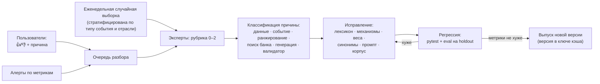

# Мониторинг качества контента, персонализации и AI (критерий 08)

Документ разделяет две вещи: что **измеряется уже в прототипе** (с указанием, где именно) и что мы **предлагаем измерять в пилоте**. Пилотные метрики — гипотезы, их целевые значения нужно калибровать на реальных данных. Оценок экономического эффекта здесь нет: прототип их не измеряет.

## 1. Что считается в прототипе

### 1.1 Онлайн-сводка `GET /api/v1/metrics/summary`

Реализация: `ai/app/storage.py:metrics_summary` для PostgreSQL и для памяти. Сводка показывается на странице «Мониторинг качества» вместе с `GET /api/v1/system/status`.

| Поле | Что значит | Группа |
|---|---|---|
| `insights_total`, `by_status` | Сколько инсайтов создано, сколько из них `completed`, `failed`, `processing` | Надёжность |
| `by_mode` | Доля режимов `llm` и `rules`. Рост `rules` при включённой LLM означает сбои LLM или исчерпанный бюджет | AI |
| `validation_pass_rate` | Доля готовых инсайтов без блокирующих замечаний валидатора после доработки | Контент, AI |
| `avg_repairs` | Среднее число доработок и prune на инсайт. Рост означает, что модель чаще отклоняется от источников | AI |
| `bank_view_found_rate` | Доля инсайтов, где найдена и подтверждена позиция банка (`bank_view.status = found`) | Контент |
| `avg_duration_ms`, `avg_chat_duration_ms` | Средняя длительность агента и ответа чата (из `ai_traces.summary`) | Производительность |
| `chat_messages` | Число сообщений в уточняющих диалогах | Вовлечённость |
| `feedback.up` / `feedback.down` | Оценки пользователей «Да, полезно» / «Нет» под инсайтом (`POST /insights/{id}/feedback`) | Пользовательская оценка |
| `llm_tokens_today`, `llm_calls_today` | Расход LLM за сутки UTC (`ai_llm_usage`) | Стоимость |
| `cache_entries` | Объём кэша ответов LLM | Стоимость |
| `llm_enabled` | Доступна ли LLM | Состояние |

`GET /api/v1/system/status` дополнительно показывает:

- `data_source` (реальные данные или синтетика), число профилей;
- версии профилей, корпуса банка и промпта;
- число новостей в базе;
- остаток дневного бюджета токенов, allowlist моделей по ролям.

### 1.2 Данные для разбора каждого случая

- **Трасса** (`ai_traces`, `GET /insights/{id}/trace`): план, вызовы инструментов со статусами `ok`/`empty`/`error`, повторные поиски (`adaptations`), замечания валидатора, модели и токены. По ней разбираются жалобы 👎.
- **Результат инсайта** (`ai_insights.result`): `validation.issues` с кодами (`unsupported_number`, `quote_not_found`, `contradicts_profile` и др.), `confidence`, `limitations`, `relevance.components`.
- **Лента** (`GET /companies/{id}/feed`): `stats` (сколько новостей рассмотрено, кластеров, отфильтровано как небизнесовые или нерелевантные) и `filtered` с причиной.

### 1.3 Офлайн-оценка персонализации (`eval/`)

- `eval/labels.csv` и `eval/labels_fresh.csv` — разметка пар «компания × новость» с меткой 0/1/2 и обоснованием. Метки автоматические (один разметчик — автор правил), ручной проверки командой не было; вторая независимая разметка моделью — `eval/labels_llm.csv`. Разбиение: `dev` (по нему настраивали правила), `holdout` (отложенная, но просмотренная при доработке — оценка оптимистична) и `fresh` (размечена после правок, до расчёта score).
- `eval/evaluate.py` прогоняет текущий ранжировщик так же, как лента, с фиксированным «сейчас» — датой снимка. Он считает Precision@3 (метка ≥ 1 и строго 2) и nDCG@5 по компаниям, а также среднее отдельно по dev и holdout. Для сравнения считаются baseline'ы, например только свежесть и только макрозначимость. Результат записывается в `eval/results.json` с разбором компонентов score по каждой паре.
- Результаты и выводы: [evaluation_report.md](evaluation_report.md).

Выборка небольшая: 50 пар, 5 компаний. Её назначение — регрессионный контроль и проверка, что персонализация лучше baseline'ов, а не статистически точная оценка.

### 1.4 Автотесты как контроль качества

`ai/tests/test_core.py` проверяет:

- одна и та же новость даёт разную значимость для разных компаний;
- небизнесовая новость получает нулевой score;
- неполный профиль снижает уверенность;
- валидатор ловит выдуманные числа и цитаты;
- агент честно останавливается на небизнесовой новости.

Тесты запускаются при каждом изменении правил, промпта или корпуса.

## 2. Метрики пилота

| Измерение | Метрика | Как считать | Источник данных |
|---|---|---|---|
| **Персонализация** | Precision@3 и nDCG@5 на отложенной разметке | Ежемесячно на новой выборке, размеченной экспертами | `eval/` + новая разметка |
| | Доля 👍 среди оценённых инсайтов, отдельно по сегментам (отрасль, роль, наличие кредита) | Из `ai_feedback` + профиль | Онлайн |
| | CTR карточек ленты по позициям; доля открытых инсайтов из топ-3 | Нужны события показа и клика | Новое логирование |
| | Доля «пустых» лент (нет high/medium) по компаниям | Из `feed.stats` | Онлайн |
| **Контент** | Доля утверждений, удалённых `prune`; распределение кодов замечаний валидатора | Из `result.validation` | Онлайн |
| | Экспертная обоснованность (рубрика, раздел 3) | Выборка по неделям | Экспертная разметка |
| | Корректность позиции банка: цитата соответствует смыслу документа, дата учтена | Эксперт аналитического центра | Экспертная разметка |
| | Покрытие тем аналитикой банка (`bank_view_found_rate` по типам событий) | Из результатов | Онлайн |
| | Свежесть: задержка от публикации до появления в ленте | `news.fetched_at − published_at` | Онлайн (поля есть) |
| | Доля дублей, не склеенных в кластер | Выборочная проверка | Экспертная |
| **AI-компоненты** | Доля режима `rules` при включённой LLM; ошибки LLM по кодам (`timeout`, `parse`, `budget`, `http`) | Трассы и логи | Онлайн |
| | Доля планов LLM, отклонённых в пользу плана на правилах; доля повторных поисков | `trace.summary.plan`, `adaptations` | Онлайн |
| | Токены и стоимость на инсайт, попадания в кэш | `ai_llm_usage`, трасса | Онлайн |
| | p50 и p95 длительности агента и чата | `ai_traces` | Онлайн |
| | Срабатывания `check_injection` | Трассы | Онлайн |
| **Уточняющие вопросы** | Доля ответов без подтверждённых утверждений; повторные вопросы в той же сессии | `ai_chat_messages.payload` | Онлайн |

## 3. Процесс регулярного мониторинга

### 3.1 Обратная связь пользователей

- Сейчас под каждым инсайтом есть кнопки «Да, полезно» и «Нет», оценка сохраняется в `ai_feedback`. API принимает и текстовую причину (`reason`, до 500 символов).
- В пилоте после 👎 предлагать выбрать причину: «не про мой бизнес», «неверный факт», «позиция банка не к месту», «нет полезного действия», «уже знал». Каждая причина отправляется в свою ветку разбора (раздел 3.3).

### 3.2 Экспертная оценка

Еженедельная выборка размечается двумя экспертами: представителем продукта или клиентского менеджера и аналитиком банка. Выборка случайная и стратифицирована по типу события и отрасли; все 👎 и алерты попадают в неё полностью. Расхождения экспертов обсуждаются, согласованность отслеживается.

| Критерий | 0 | 1 | 2 |
|---|---|---|---|
| Обоснованность | Есть неверный факт или утверждение без источника | Факты верны, но часть выводов слабо связана с источниками | Каждый вывод следует из указанных источников, ограничения названы |
| Персонализация | Вывод подходит любой компании | Учтена отрасль, но не признаки конкретного клиента | Связь через конкретные признаки клиента: продукты, ВЭД, контрагенты, регион |
| Конкретность | Общие слова, пересказ новости | Механизм назван, но без условий и горизонта | Механизм, условия, что неизвестно и что отслеживать |
| Полезность | Действие не нужно или не применимо | Действие разумно, но общее | Конкретный следующий шаг или вопрос, привязанный к пробелу в данных |

Отдельный бинарный критерий — **корректность позиции банка**:

- цитата есть в документе и передаёт его смысл;
- дата документа учтена: прогноз не выдан за комментарий к событию;
- позиция банка не смешана с выводом модели.

Эталон уровня — пример продукта «Ключевая ставка» (U_1595 и U_8167). Его же используем как регрессионный кейс.

### 3.3 Куда направлять найденные проблемы

| Причина | Где исправлять |
|---|---|
| Неверный тип события или отрасль | `ai/app/events.py` (лексикон, триггеры); версия экстрактора меняет кэш событий |
| Неверная значимость | Веса и компоненты в `ai/app/ranking.py`, каналы в `profiles.py`; проверка на `eval/` |
| Не найдена или не та позиция банка | Синонимы и темы в `bank.py`, разметка тем документов в `scripts/build_bank_corpus.py`, новые документы банка |
| Слабая интерпретация | Механизмы и пробелы в `mechanisms.py`, промпт в `writer.py` (`PROMPT_VERSION`) |
| Фактическая ошибка, прошедшая валидатор | Новое правило в `validator.py` и тест на этот случай |

### 3.4 Алерты (пороги стартовые, калибруются в пилоте)

| Условие | Действие |
|---|---|
| `by_status.failed` за час > 5% инсайтов | Дежурный разбирает трассы и логи |
| Доля `rules` при `llm_enabled = true` > 20% за час | Проверить доступность LLM, ошибки `parse` и `timeout`, остаток бюджета |
| `llm_tokens_today` > 80% `LLM_DAILY_TOKEN_BUDGET` | Предупреждение; при 100% — режим `rules` (автоматически) |
| `validation_pass_rate` за сутки упал > 10 п.п. относительно 7-дневной медианы | Блокировать выпуск новой версии промпта, разбор кодов замечаний |
| `bank_view_found_rate` упал > 10 п.п. | Проверить корпус и поиск, появились ли темы без аналитики |
| Доля 👎 за неделю > 30% при ≥ 30 оценках | Внеплановая экспертная сессия |
| Импорт RSS: источник с ошибкой более 3 запусков подряд | Проверить ленту (видно в ответе `POST /api/v1/news/import` и логах шлюза) |
| p95 длительности агента > `AGENT_MAX_SECONDS` × 0.8 | Проверить LLM и размер плана |

В прототипе сводка доступна через API и UI. В пилоте метрики выгружаются в систему мониторинга (Prometheus/Grafana или банковский аналог) по расписанию, а алерты настраиваются там.

### 3.5 Регулярная переоценка

- **Еженедельно.** Экспертная выборка, обзор 👎, отчёт по метрикам раздела 2.
- **Перед каждым выпуском** (правила, веса, промпт, корпус, модель). `pytest` и `eval/evaluate.py` на отложенной выборке. Выпуск допускается, если метрики на holdout не ухудшились. Новая версия промпта, корпуса или профилей автоматически меняет ключ кэша инсайтов.
- **Ежемесячно.** Новая порция разметки свежих новостей, которые не использовались при настройке. Прежняя отложенная выборка переходит в dev, новая становится holdout. Так проверяется устойчивость на ранее не показанных новостях (критерий 05).
- **При появлении новых материалов банка.** Пересборка корпуса (`scripts/build_bank_corpus.py`) и проверка `bank_view_found_rate` и корректности позиции банка на выборке.
